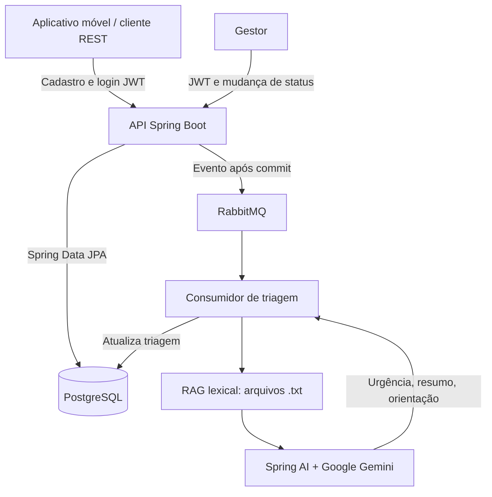
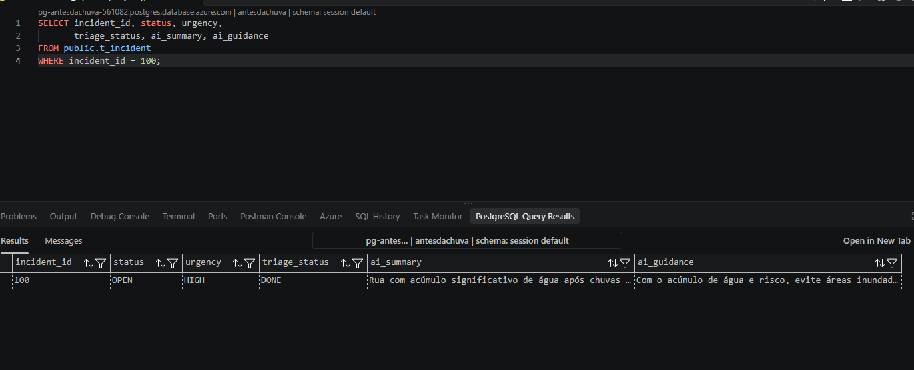

# Antes da Chuva

**Plataforma de zeladoria preventiva para registrar ocorrências urbanas e apoiar a triagem com inteligência artificial.**

Projeto acadêmico da **FIAP — Global Solution 2026/2 (CitizenTech)**, desenvolvido para as disciplinas de **Java Advanced** e **Disruptive Architectures: IoT, IoB & Generative IA**.

> **Aviso:** a urgência calculada pela IA é uma sugestão para apoiar a análise humana. O projeto não é um sistema oficial de alerta meteorológico ou de Defesa Civil.

## Integrantes

**Turma:** 2TDSPO

| Aluno | RM |
|---|---|
| Gustavo Gomes Martins | 555999 |
| Pedro dos Anjos | 563832 |
| Matheus de Mattos Vecchi | 561716 |
| Nicholas Albuquerque Buzo | 561082 |
| Nicholas Camillo Canadas de Paula | 561262 |

## Problema e proposta

Bueiros obstruídos, pontos de alagamento, entulho e problemas de drenagem urbana podem ser difíceis de comunicar e acompanhar. O **Antes da Chuva** centraliza relatos de cidadãos, registra seu andamento e auxilia a priorização de atendimentos.

O cidadão informa a categoria, o local e a descrição de uma ocorrência. A API armazena o registro, publica um evento para processamento assíncrono e utiliza **Spring AI + Google Gemini**, com contexto recuperado de uma base local de orientações (**RAG básico**), para sugerir uma urgência e redigir um resumo e uma orientação preventiva. O gestor acompanha as ocorrências e registra mudanças de status com histórico.

## API publicada e demonstração

- **Swagger / OpenAPI:** https://app-antesdachuva-561082.azurewebsites.net/swagger-ui/index.html
- **Health check:** https://app-antesdachuva-561082.azurewebsites.net/actuator/health
- **Código-fonte (branch de desenvolvimento):** https://github.com/gugomesx10/Antes-da-Chuva/tree/develop
- **Vídeo pitch (até 5 minutos):** **[Adicionar link público ou não listado antes da entrega]**

O ambiente publicado foi utilizado em um teste de ponta a ponta: uma ocorrência foi cadastrada pelo Swagger e o resultado da triagem foi consultado no PostgreSQL. A disponibilidade do ambiente durante a correção depende dos serviços externos configurados.

## Arquitetura e fluxo de processamento



1. O cidadão se autentica e envia `POST /incidents`.
2. A aplicação valida e persiste a ocorrência com `status=OPEN` e `triageStatus=PENDING`.
3. Após a confirmação da transação, é publicado o ID da ocorrência no RabbitMQ.
4. O consumidor recupera o relato, consulta os documentos locais via `RagKnowledgeService` e envia o contexto ao Gemini por meio do `IncidentAiService`.
5. O processamento grava `urgency`, `aiSummary`, `aiGuidance` e `triageStatus=DONE`. Respostas inválidas ou falhas de execução são registradas como `FAILED`.
6. O gestor pode avançar o atendimento por etapas, mantendo um histórico das transições.

A publicação e o consumo usam o fluxo assíncrono do Spring AMQP. O projeto também possui uma tentativa periódica de reenvio para ocorrências antigas ainda pendentes; isso **não constitui garantia transacional completa de entrega**.

## Tecnologias

| Finalidade | Implementação |
| --- | --- |
| Backend | Java 21, Spring Boot 4.1.2, Spring Web MVC |
| Persistência | Spring Data JPA, PostgreSQL, Flyway |
| Segurança | Spring Security, JWT HS256, BCrypt |
| Validação e erros | Jakarta Bean Validation, `@RestControllerAdvice` |
| Mensageria | Spring AMQP e RabbitMQ |
| IA generativa | Spring AI 2.0.2, Google Gemini 2.5 Flash |
| Recuperação de conhecimento | RAG básico com busca lexical em arquivos `.txt` |
| Documentação de endpoints | Springdoc OpenAPI / Swagger UI |
| Testes | JUnit 5, Mockito, MockMvc e H2 no perfil `test` |
| Hospedagem da API e banco | Azure App Service e Azure Database for PostgreSQL |

## Domínio e permissões

Entidades principais: `User`, `Category`, `Incident` e `IncidentUpdate`. A modelagem inclui também `Endorsement` e `IncidentAudit`.

- **CIDADAO:** cadastra-se, autentica-se, registra e acompanha ocorrências; pode editar ou cancelar suas próprias ocorrências enquanto estão abertas.
- **GESTOR:** autentica-se, administra categorias e registra mudanças de status de ocorrências.

O cadastro público (`POST /auth/register`) cria usuários do perfil `CIDADAO`; a aplicação não permite selecionar o papel `GESTOR` no cadastro.

**Estados da ocorrência:** `OPEN`, `IN_REVIEW`, `IN_PROGRESS`, `RESOLVED`, `REJECTED`, `CANCELLED`.

**Urgência sugerida:** `LOW`, `MEDIUM`, `HIGH`, `CRITICAL`.

**Situação da triagem:** `PENDING`, `DONE`, `FAILED`.

Transições de atendimento aceitas: `OPEN` → `IN_REVIEW` ou `REJECTED`; `IN_REVIEW` → `IN_PROGRESS` ou `REJECTED`; `IN_PROGRESS` → `RESOLVED` ou `REJECTED`.

## Endpoints REST

| Método | Endpoint | Descrição | Permissão |
| --- | --- | --- | --- |
| `POST` | `/auth/register` | Cadastro de cidadão | Público |
| `POST` | `/auth/login` | Login e emissão de JWT | Público |
| `GET` | `/auth/me` | Usuário autenticado | Autenticado |
| `GET` | `/categories` | Listagem paginada de categorias | Autenticado |
| `GET` | `/categories/{id}` | Detalhe da categoria | Autenticado |
| `POST` | `/categories` | Cadastro de categoria | GESTOR |
| `PUT` | `/categories/{id}` | Edição de categoria | GESTOR |
| `DELETE` | `/categories/{id}` | Desativação lógica da categoria | GESTOR |
| `GET` | `/incidents` | Lista paginada, filtros de status, categoria e bairro | Autenticado |
| `GET` | `/incidents/mine` | Ocorrências do usuário | CIDADAO |
| `GET` | `/incidents/{id}` | Detalhes da ocorrência | Autenticado |
| `POST` | `/incidents` | Registro de ocorrência | CIDADAO |
| `PUT` | `/incidents/{id}` | Edição da própria ocorrência aberta | CIDADAO |
| `DELETE` | `/incidents/{id}` | Cancelamento lógico da própria ocorrência aberta | CIDADAO |
| `GET` | `/incidents/{incidentId}/updates` | Histórico do atendimento | Autenticado |
| `POST` | `/incidents/{incidentId}/updates` | Alteração de status | GESTOR |

Os endpoints protegidos exigem `Authorization: Bearer <TOKEN_JWT>`. As listagens usam paginação Spring Data; `GET /incidents` aceita filtros opcionais `status`, `categoryId` e `neighborhood`.

### Exemplo: cadastro e autenticação

`POST /auth/register`:

```json
{
  "name": "Pessoa Exemplo",
  "email": "pessoa.exemplo@example.com",
  "password": "SenhaExemplo2026!",
  "neighborhood": "Mooca"
}
```

Depois, utilize `POST /auth/login` com e-mail e senha para receber `accessToken`. Na interface Swagger, clique em **Authorize** e informe o token.

### Exemplo: criar ocorrência

`POST /incidents` com JWT de cidadão:

```json
{
  "categoryId": 3,
  "title": "Ponto de alagamento após chuva forte",
  "description": "Há água acumulada na rua, dificultando a passagem de moradores.",
  "address": "Rua Exemplo, 200",
  "neighborhood": "Mooca",
  "latitude": -23.551,
  "longitude": -46.631
}
```

As categorias iniciais são criadas por `V2__seed_categories.sql`: bueiro entupido, entulho em via pública, ponto de alagamento, córrego assoreado e árvore em risco.

## IA generativa e RAG básico — IoT / Disruptive Architectures

A funcionalidade de IA foi construída para auxiliar a **triagem de relatos urbanos**, e não como chatbot independente. O `IncidentAiService` utiliza o Gemini para obter três resultados estruturados: urgência sugerida, resumo e orientação preventiva.

### Fonte e preparação do conhecimento

Os textos de referência são armazenados em `src/main/resources/knowledge/`:

| Arquivo | Tema | Referência utilizada na preparação |
| --- | --- | --- |
| `bueiros.txt` | Obstruções, lixo e drenagem | [Orientações de prevenção — gov.br](https://www.gov.br/mdr/pt-br/noticias/defesa-civil-prevencao-ajuda-a-evitar-desastres-naturais) |
| `alagamentos.txt` | Segurança durante alagamentos | [CGE — Prefeitura de São Paulo](https://cge.prefeitura.sp.gov.br/v3/dicas.jsp) |
| `prevencao.txt` | Preparação e proteção do cidadão | [Guia sobre enchentes — Ministério da Saúde](https://miniapps.saude.gov.br/guia-clima/como-podemos-contribuir/populacao-em-geral/enchentes-e-inundacoes) |

O conteúdo desses arquivos é uma síntese textual preparada para o projeto, não uma coleta em tempo real. O `RagKnowledgeService` normaliza os textos para minúsculas, remove acentos e pontuação, considera palavras de quatro ou mais caracteres e seleciona **até dois documentos** com maior sobreposição de termos. Em seguida, o prompt do `IncidentAiService` fornece os trechos recuperados ao Gemini.

**Justificativa:** como o acervo é pequeno e controlado, a recuperação lexical permite integração simples e rastreável. Não há treinamento de modelo próprio, embeddings ou banco vetorial. A técnica pode falhar para sinônimos ou relatos pouco específicos.

### Critérios de avaliação e limitações

A avaliação considera pertinência das fontes recuperadas, fidelidade do resumo, coerência da urgência com a descrição, segurança das orientações e tratamento de falhas. O projeto não possui amostra humana ampla o suficiente para declarar uma taxa de precisão ou acerto da IA.

O Gemini pode errar, omitir contexto ou propor orientações insuficientes. Não são consultados dados meteorológicos em tempo real nem emitidos alertas oficiais; a classificação deve ser validada por um responsável. Em caso de indisponibilidade ou resposta inválida, o fluxo prevê `triageStatus=FAILED`.

**Documentação complementar com arquitetura, matriz de testes, evidência e limitações:** [Avaliação da IA e do RAG](docs/AVALIACAO_IA.md).

## Evidência de execução — ocorrência 100

Durante um teste com a API hospedada, a ocorrência `100` foi registrada inicialmente com `OPEN`, `PENDING` e campos de IA ainda vazios. Em uma consulta posterior ao PostgreSQL, foram observados:

| Campo | Resultado observado |
| --- | --- |
| `incident_id` | `100` |
| `status` | `OPEN` |
| `urgency` | `HIGH` |
| `triage_status` | `DONE` |
| `ai_summary` | Preenchido |
| `ai_guidance` | Preenchido |



O registro comprova a **persistência do resultado de triagem**. Uma confirmação específica da publicação e do consumo no RabbitMQ exige também os logs correspondentes; o print do banco, isoladamente, não mede a mensageria.

```sql
SELECT incident_id, status, urgency,
       triage_status, ai_summary, ai_guidance
FROM public.t_incident
WHERE incident_id = 100;
```

## Executar localmente

**Pré-requisitos:** JDK 21 e acesso a instâncias configuradas de PostgreSQL, RabbitMQ e Gemini. Use credenciais e segredos via variáveis de ambiente, nunca versionados no Git.

```dotenv
DB_URL=jdbc:postgresql://<servidor>:5432/<banco>?sslmode=require
DB_USERNAME=<usuario>
DB_PASSWORD=<senha>
RABBITMQ_HOST=<servidor>
RABBITMQ_PORT=5672
RABBITMQ_USERNAME=<usuario>
RABBITMQ_PASSWORD=<senha>
RABBITMQ_SSL_ENABLED=false
GEMINI_API_KEY=<chave-da-api>
AI_MODEL=gemini-2.5-flash
JWT_SECRET=<segredo-base64-de-pelo-menos-32-bytes>
JWT_ISSUER=https://antes-da-chuva.example
JWT_EXPIRATION_SECONDS=3600
PORT=8080
```

Se o serviço RabbitMQ exigir TLS, configure a porta e `RABBITMQ_SSL_ENABLED=true`. As tabelas são controladas pelas migrations em `src/main/resources/db/migration` e validadas pelo Hibernate na inicialização.

**Linux/macOS:**

```bash
./mvnw clean verify
./mvnw spring-boot:run
```

**Windows (PowerShell):**

```powershell
.\mvnw.cmd clean verify
.\mvnw.cmd spring-boot:run
```

A execução do servidor fora do perfil de teste requer os serviços externos operacionais. A documentação de infraestrutura e scripts de provisionamento estão em `scripts/`, mantidos pela frente de DevOps do grupo.

### Usuários de demonstração e segurança

O projeto possui a migration `V3__seed_test_users.sql` com contas de demonstração usadas em testes e correção. **Atenção:** como as credenciais históricas dessas contas foram incluídas no repositório público, **não devem ser consideradas seguras em um ambiente exposto à internet**. Antes da avaliação em serviço público, as senhas e a disponibilidade das contas precisam ser revistas/rotacionadas por quem administra o ambiente. A inclusão de uma migration já aplicada não deve ser modificada retroativamente: correções de dados devem ser realizadas de modo compatível com o Flyway.

A equipe deve disponibilizar aos avaliadores somente credenciais de teste **controladas**, nunca segredos operacionais, chaves Gemini ou tokens JWT.

## Testes automatizados

O perfil `test` utiliza H2 em memória no modo compatível com PostgreSQL, executa migrations Flyway e não depende do Gemini nem de broker RabbitMQ real para testar o fluxo HTTP.

```bash
./mvnw clean verify
```

Os testes incluem:

- RAG lexical: recuperação relacionada, limite de documentos e ausência de correspondência.
- Triagem: resultado válido, falha de IA e ocorrência cancelada.
- Autenticação e autorização: JWT, retorno `401` sem token e `403` quando a função não tem permissão.
- Integração HTTP com MockMvc: cadastro, ocorrência, histórico de status, conflito `409`, cancelamento e validações `400`.

`IncidentAiIntegrationIT` executa uma chamada **real** à API do Gemini e requer `GEMINI_API_KEY` no ambiente. Não faz parte da execução independente de serviços externos.

```bash
./mvnw -Dtest=IncidentAiIntegrationIT test
```

O resultado do teste deve ser registrado conforme a execução real; nenhuma quantidade de testes ou taxa de sucesso é presumida nesta documentação.

## Integração com Mobile

A API fornece cadastro/login JWT, endpoints de categorias e CRUD de ocorrências que podem ser consumidos pelo aplicativo Mobile com Axios ou Fetch. O grupo deve demonstrar, na apresentação de Java, a integração **real** entre o aplicativo e a API, e não apenas as rotas no Swagger. O estado de publicação e das telas do aplicativo deve ser confirmado com a equipe responsável por Mobile.

## Declaração de uso de inteligência artificial

**No produto:** o sistema utiliza Google Gemini 2.5 Flash via Spring AI para sugerir urgência, gerar resumo e fornecer orientação preventiva. O RAG básico seleciona contexto em documentos de referência locais. As saídas são tratadas como apoio à decisão, não como determinações oficiais.

**No desenvolvimento:** o ChatGPT foi utilizado como ferramenta de apoio para compreensão técnica, revisão, testes e organização da documentação. As decisões de implementação e a validação dos resultados devem ser revisadas pela equipe. **[Complementar aqui se foram utilizadas outras ferramentas de IA.]**

## Entregas acadêmicas

- **Java Advanced:** repositório público com documentação de execução, principais endpoints, JWT e perfis, opção distribuída adotada (**RabbitMQ**), descrição do Spring AI, link do deploy e declaração de IA. Enviar o **ZIP** no Portal do Aluno contendo `TXT` de identificação (nome completo, RM e turma), link do repositório e link do vídeo pitch de **até 5 minutos**.
- **Disruptive Architectures / IoT & IA generativa:** repositório com código, justificativa do RAG, preparação das fontes, arquitetura, critérios, testes e limitações. Enviar **apenas o TXT** de identificação e link do repositório, conforme a orientação da disciplina.
- **Apresentação presencial:** preparar demonstração funcional e domínio técnico da arquitetura, JWT, Spring AI, mensageria, RAG, limitações e fluxo de atendimento.

---

**FIAP — Global Solution 2026/2 · Antes da Chuva**
