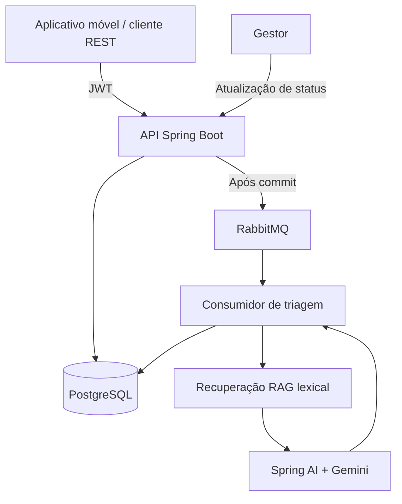

# Antes da Chuva

**Plataforma de zeladoria preventiva com triagem assistida por inteligência artificial.**

Projeto da **Global Solution FIAP — 2026/2**. Cidadãos registram problemas urbanos associados a drenagem e alagamentos; gestores acompanham o atendimento e atualizam o andamento. A classificação pela IA é uma **sugestão**, não um alerta oficial da Defesa Civil.

## O problema e a solução

Ocorrências como bueiros obstruídos, entulho em vias públicas e pontos de alagamento podem ser difíceis de acompanhar quando os relatos são descentralizados. O Antes da Chuva centraliza esses registros, mantém o histórico de atendimento e usa IA para sugerir urgência e orientações preventivas.

## Arquitetura



**Fluxo:** o cidadão autentica-se, registra uma ocorrência e recebe um identificador. O Java persiste o registro com `OPEN` e `PENDING`, publica seu ID na fila após a transação e o consumidor solicita a análise da IA. O resultado é persistido em `urgency`, `aiSummary`, `aiGuidance` e `triageStatus`. O gestor pode registrar mudanças de status com histórico.

## Stack

| Camada | Tecnologia |
| --- | --- |
| Linguagem | Java 21 |
| API | Spring Boot 4.1.2 / Spring Web MVC |
| Autenticação | Spring Security, JWT HS256 e BCrypt |
| Persistência | Spring Data JPA, PostgreSQL e Flyway |
| Assíncrono | Spring AMQP / RabbitMQ |
| IA | Spring AI 2.0.2 / Google Gemini |
| RAG | Recuperação lexical em documentos de prevenção |
| Documentação | OpenAPI / Swagger UI |
| Testes | JUnit 5, Mockito e MockMvc |
| Infraestrutura | Azure (deploy planejado) |

## Perfis e domínio

- `CIDADAO`: registra, consulta e, quando permitido, edita ou cancela ocorrências próprias.
- `GESTOR`: gerencia categorias e atualiza o status de ocorrências.
- O cadastro público cria apenas `CIDADAO`; o `GESTOR` inicial é criado pela migration `V3__seed_test_users.sql`.

### Usuários de teste

| Perfil | E-mail | Senha |
| --- | --- | --- |
| GESTOR | `gestor@antesdachuva.com` | `Gestor@2026` |
| CIDADAO | `maria@antesdachuva.com` | `Cidadao@2026` |
| CIDADAO | `joao@antesdachuva.com` | `Cidadao@2026` |

Contas exclusivas para demonstração e correção, com senhas armazenadas em BCrypt. Novos cidadãos podem se cadastrar por `POST /auth/register`.

Entidades principais: `User`, `Category`, `Incident`, `IncidentUpdate`; a modelagem inclui `Endorsement` e `IncidentAudit`.

Status: `OPEN`, `IN_REVIEW`, `IN_PROGRESS`, `RESOLVED`, `REJECTED`, `CANCELLED`.

Urgência: `LOW`, `MEDIUM`, `HIGH`, `CRITICAL`. Triagem: `PENDING`, `DONE`, `FAILED`.

## Endpoints

| Método | Rota | Objetivo | Acesso |
| --- | --- | --- | --- |
| POST | `/auth/register` | Cadastro | Público |
| POST | `/auth/login` | Login / JWT | Público |
| GET | `/auth/me` | Usuário atual | Autenticado |
| GET | `/categories` | Lista paginada | Autenticado |
| GET | `/categories/{id}` | Detalhe | Autenticado |
| POST | `/categories` | Criar categoria | GESTOR |
| PUT | `/categories/{id}` | Atualizar categoria | GESTOR |
| DELETE | `/categories/{id}` | Desativar categoria | GESTOR |
| GET | `/incidents` | Listagem com filtros | Autenticado |
| GET | `/incidents/mine` | Minhas ocorrências | CIDADAO |
| GET | `/incidents/{id}` | Detalhe | Autenticado |
| POST | `/incidents` | Registrar ocorrência | CIDADAO |
| PUT | `/incidents/{id}` | Editar ocorrência própria | CIDADAO |
| DELETE | `/incidents/{id}` | Cancelar ocorrência própria | CIDADAO |
| GET | `/incidents/{incidentId}/updates` | Histórico de status | Autenticado |
| POST | `/incidents/{incidentId}/updates` | Alterar status | GESTOR |

`GET /incidents` aceita `status`, `categoryId` e `neighborhood` como filtros opcionais. Endpoints de listagem oferecem paginação.

**Swagger:** `/swagger-ui/index.html` • **Saúde:** `/actuator/health`.

### Exemplo de cadastro

```json
{
  "name": "Pessoa Exemplo",
  "email": "pessoa.exemplo@example.com",
  "password": "SenhaExemplo2026!",
  "neighborhood": "Mooca"
}
```

Envie para `POST /auth/register`.

### Exemplo de ocorrência

```json
{
  "categoryId": 1,
  "title": "Bueiro obstruído por lixo",
  "description": "Há acúmulo de água na rua após as chuvas.",
  "address": "Rua Exemplo, 100",
  "neighborhood": "Mooca",
  "latitude": -23.550000,
  "longitude": -46.630000
}
```

Envie para `POST /incidents` com `Authorization: Bearer <TOKEN_JWT>`. A categoria `1` é **Bueiro entupido**, criada pela migration `V2__seed_categories.sql`.

## RAG e IA

Os documentos em `src/main/resources/knowledge/` abrangem bueiros, alagamentos e prevenção. O `RagKnowledgeService` normaliza palavras e seleciona até dois documentos relacionados ao relato. O `IncidentAiService` passa esses trechos como contexto para o Gemini e recebe um `AiTriageResult` com urgência, resumo e orientação.

**Limite técnico:** o RAG é lexical, sem embeddings nem banco vetorial. Não há previsão meteorológica em tempo real nem validação oficial dos relatos.

## Configuração para execução

Requer **Java 21**, acesso a **PostgreSQL**, **RabbitMQ** e **Gemini API**. Os serviços podem ser remotos. Configure as variáveis de ambiente no host de execução, nunca no repositório:

```dotenv
DB_URL=jdbc:postgresql://<servidor>:5432/<banco>?sslmode=require
DB_USERNAME=<usuario>
DB_PASSWORD=<senha>
RABBITMQ_HOST=<servidor>
RABBITMQ_PORT=5672
RABBITMQ_USERNAME=<usuario>
RABBITMQ_PASSWORD=<senha>
RABBITMQ_SSL_ENABLED=false
GEMINI_API_KEY=<chave>
AI_MODEL=gemini-2.5-flash
JWT_SECRET=<segredo-base64-de-pelo-menos-32-bytes>
JWT_ISSUER=https://antes-da-chuva.example
JWT_EXPIRATION_SECONDS=3600
PORT=8080
```

Se o RabbitMQ exigir TLS, ajuste `RABBITMQ_SSL_ENABLED=true` e a porta do serviço (frequentemente `5671`). As tabelas e categorias iniciais são geradas pelas migrations Flyway em `src/main/resources/db/migration`.

### Build e inicialização

```bash
mvnd clean package -DskipTests
java -jar target/Global-Solution-Antes-Da-Chuva-0.0.1-SNAPSHOT.jar
```

O projeto também possui Maven Wrapper (`./mvnw`). O JAR depende dos serviços e segredos configurados para inicializar corretamente.

## Infraestrutura no Azure

Toda a infraestrutura é criada por scripts Azure CLI em `scripts/`, sem nenhum segredo no código: senhas e chaves vêm de `scripts/.env` (local, fora do Git) ou do Variable Group do Azure DevOps.

| Recurso | Nome | Uso |
| --- | --- | --- |
| Resource Group | `rg-antesdachuva` | Agrupa tudo |
| Azure Database for PostgreSQL Flexible Server | `pg-antesdachuva-<RM>` | Banco da aplicação (Flyway cria as tabelas) |
| Azure Container Registry | `acrantesdachuva<RM>` | Imagem do RabbitMQ (`dockerfiles/rabbitmq`) |
| Azure Container Instances | `aci-rabbitmq-antesdachuva` | RabbitMQ (AMQP 5672, painel 15672) |
| App Service Plan B1 Linux + Web App Java 21 | `app-antesdachuva-<RM>` | API |

```bash
cp scripts/.env.example scripts/.env   # preencha RM, senhas, JWT_SECRET e GEMINI_API_KEY
az login
./scripts/azure-setup.sh               # cria os recursos e as App Settings (pode ser executado de novo)
./scripts/azure-deploy.sh              # build + deploy manual do jar (antes da Release do DevOps)
./scripts/azure-delete.sh              # remove tudo (somente após o fim da correção)
```

| Arquivo | Conteúdo |
| --- | --- |
| `scripts/script-bd.sql` | DDL completo do PostgreSQL (consolidação das migrations Flyway) |
| `dockerfiles/rabbitmq/Dockerfile` | Imagem do RabbitMQ publicada no ACR e executada no ACI |
| `dockerfiles/app/Dockerfile` | Imagem da API (build multi-stage, Java 21) |

## Testes e estado atual

A suíte roda sem nenhum serviço externo: o perfil `test` (`src/test/resources/application-test.yml`) usa H2 em memória em modo PostgreSQL, aplica as mesmas migrations Flyway da produção (incluindo os usuários de teste) e desliga o consumidor do RabbitMQ e o Gemini.

```bash
./mvnw clean verify    # 27 testes: unitários + integração HTTP com H2
```

| Tipo | Cobertura |
| --- | --- |
| Unitários (Mockito) | Cadastro, login, JWT, mapeamento de perfis, RAG, triagem, reenvio de pendentes |
| Segurança (MockMvc) | 401 sem token, 403 por perfil em categorias |
| Integração (`IncidentFlowIntegrationTest`) | Login do GESTOR, cadastro, criação de ocorrência sem RabbitMQ disponível, mudança de status, transição inválida (409), linha do tempo, cancelamento, validação (400) |

O teste `IncidentAiIntegrationIT` chama o Gemini de verdade e não roda no build padrão: `GEMINI_API_KEY=... ./mvnw -Dtest=IncidentAiIntegrationIT test`. Nele, um relato fictício de bueiro entupido recebeu a urgência `HIGH`, com resumo e orientação preventiva.

### Integração contínua (Azure DevOps)

O arquivo `azure-pipeline.yml` na raiz define o pipeline de build: dispara somente no merge na `main`, executa `./mvnw clean verify`, publica os resultados JUnit e publica o `.jar` como artefato `drop`, consumido pela Release que faz o deploy no Web App.

**Ainda pendente:** reforçar idempotência/reenvio de mensagens. O agendamento atual tenta reenviar ocorrências pendentes antigas, mas não oferece uma garantia transacional completa de entrega.

## Organização

```text
src/main/java/br/com/fiap/gs/
├── ai/
├── config/
├── controller/
├── dto/
├── entity/
├── enums/
├── exception/
├── mapper/
├── messaging/
├── repository/
├── security/
└── service/
src/main/resources/
├── application.yml
├── db/migration/
└── knowledge/
```

---

**FIAP — Global Solution 2026/2 | Antes da Chuva**
