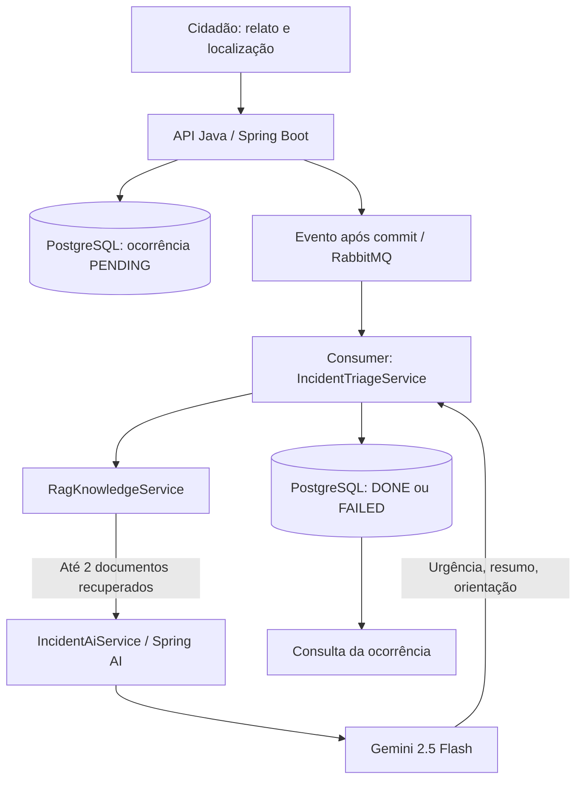
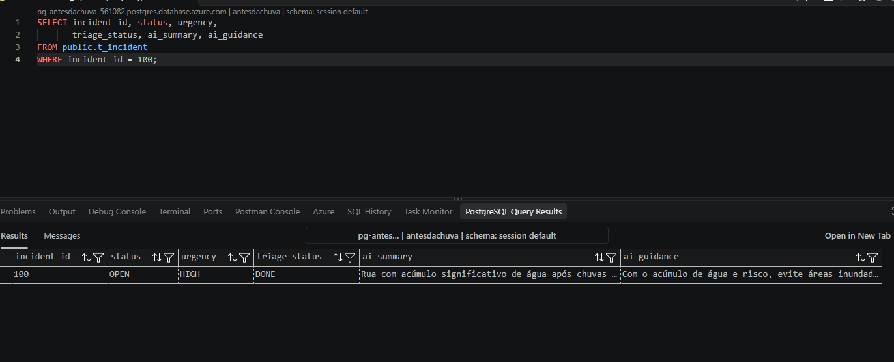

# Antes da Chuva — Evidências e avaliação da IA

**FIAP — Global Solution 2026/2**  
**Disciplina:** Disruptive Architectures: IoT, IoB & Generative IA  
**Repositório:** https://github.com/gugomesx10/Antes-da-Chuva/tree/develop

## 1. Funcionalidade e benefício ao cidadão

O Antes da Chuva recebe relatos de problemas de drenagem e alagamentos, organiza o acompanhamento das ocorrências e fornece uma sugestão de urgência acompanhada de resumo e orientação preventiva. A análise auxilia a priorização pela gestão; não é alerta oficial nem decisão autônoma definitiva.

## 2. Arquitetura implementada



O fluxo assíncrono separa o registro da ocorrência do processamento com IA. O resultado é gravado em `urgency`, `ai_summary`, `ai_guidance` e `triage_status`.

## 3. RAG básico: implementação e justificativa

**Técnica escolhida:** recuperação lexical em arquivos de texto, seguida de geração pelo Gemini com os trechos recuperados no prompt.

**Classes:** `src/main/java/br/com/fiap/gs/ai/RagKnowledgeService.java`, `IncidentAiService.java`, `KnowledgeExcerpt.java` e `AiTriageResult.java`.

**Preparação:** síntese manual de orientações de prevenção em três arquivos `.txt`; leitura pelo classpath; normalização para minúsculas; remoção de acentos e caracteres não alfanuméricos; comparação dos termos com pelo menos quatro caracteres. O serviço seleciona até dois documentos por sobreposição lexical.

| Documento | Tema | Referência associada no código |
| --- | --- | --- |
| `bueiros.txt` | Obstruções e drenagem urbana | [Ministério das Cidades / Defesa Civil](https://www.gov.br/mdr/pt-br/noticias/defesa-civil-prevencao-ajuda-a-evitar-desastres-naturais) |
| `alagamentos.txt` | Orientações em alagamentos | [CGE São Paulo](https://cge.prefeitura.sp.gov.br/v3/dicas.jsp) |
| `prevencao.txt` | Preparação e cuidados preventivos | [Ministério da Saúde](https://miniapps.saude.gov.br/guia-clima/como-podemos-contribuir/populacao-em-geral/enchentes-e-inundacoes) |

**Justificativa:** um corpus pequeno e controlado dispensa infraestrutura vetorial e permite explicar exatamente como o contexto é selecionado. A limitação é o reconhecimento imperfeito de sinônimos e associações semânticas. Não se treinou um modelo próprio; não foram usados embeddings nem banco vetorial.

## 4. Evidência real da integração

Em teste via Swagger com o PostgreSQL hospedado, a ocorrência **ID 100** foi gravada inicialmente com `OPEN` e triagem `PENDING`. Em nova consulta SQL, a mesma ocorrência apareceu com `urgency=HIGH`, `triage_status=DONE`, `ai_summary` e `ai_guidance` preenchidos. A classificação `HIGH` é um resultado observado nesse caso — não um valor fixo esperado para todas as ocorrências.



Consulta de verificação:

```sql
SELECT incident_id, title, status, urgency, triage_status,
       ai_summary, ai_guidance
FROM public.t_incident
WHERE incident_id = 100;
```

**Alcance da evidência:** o SELECT confirma a persistência do resultado. Para comprovar separadamente a publicação e o consumo no RabbitMQ, utilizar registros de log do Publisher e do Consumer, caso estejam disponíveis. Não confundir a evidência do banco com uma medição da fila.

## 5. Critérios para avaliar os resultados

As saídas de LLM podem variar. Em vez de impor um valor exato de urgência para cada texto, adotam-se critérios verificáveis:

| Critério | Como avaliar |
| --- | --- |
| Fidelidade do resumo | O resumo representa o relato sem acrescentar fatos não fornecidos |
| Coerência da urgência | A sugestão é proporcional à gravidade descrita; eventuais ambiguidades são registradas |
| Segurança da orientação | A resposta evita condutas arriscadas e não substitui autoridades |
| Pertinência do RAG | O documento recuperado é coerente com os termos do relato |
| Confiabilidade técnica | Resposta tem estrutura válida; falhas são sinalizadas sem apagar a ocorrência |

## 6. Matriz de testes

| ID | Entrada/cenário | Resultado observado | Avaliação / evidência |
| --- | --- | --- | --- |
| IA-01 | Relato fictício de alagamento próximo a moradias | Ocorrência 100: `HIGH`, `DONE`, resumo e orientação não vazios | **Observado** na consulta SQL e no print anexo. Avaliar texto completo antes de classificar qualidade |
| IA-02 | Bueiro obstruído por lixo, sem informação de inundação | Ainda não registrado nesta avaliação | **A executar**: verificar pertinência da urgência e orientação |
| IA-03 | Córrego com assoreamento e risco à drenagem | Ainda não registrado nesta avaliação | **A executar**: verificar documentos e resumo |
| IA-04 | Relato curto/vago, com poucos detalhes | Ainda não registrado nesta avaliação | **A executar**: evitar afirmações indevidas e previsões inventadas |
| IA-05 | Falha simulada da API Gemini | O teste unitário `IncidentTriageServiceTest.shouldFailWhenAiThrowsException` verifica `FAILED` em memória | **Cobertura unitária**, não falha real comprovada em nuvem |
| IA-06 | Entrada não relacionada ao acervo (xadrez/astronomia/telescópio) | Teste `RagKnowledgeServiceTest.shouldReturnEmptyForUnrelatedInput` verifica lista vazia | **Cobertura unitária** da recuperação lexical |

Não se declara taxa de acerto, precisão ou percentual de qualidade porque não há um conjunto de resultados humanos avaliados suficientemente amplo documentado até este momento. Ao concluir mais casos, registrar respostas completas, critérios de aceitação e número de execuções.

## 7. Como reproduzir e localizar os testes

O projeto tem testes de RAG, triagem e integração com HTTP/JWT. Com o Maven Wrapper na raiz do repositório:

```bash
./mvnw clean verify
```

O teste `IncidentAiIntegrationIT` faz chamada real ao Gemini e requer `GEMINI_API_KEY` configurada no ambiente. Por depender de serviço externo, é separado dos testes convencionais:

```bash
./mvnw -Dtest=IncidentAiIntegrationIT test
```

Guarde o resultado real do comando executado antes da entrega e não exponha chaves nem tokens ao capturar a evidência.

## 8. Limitações e uso responsável

- O RAG lexical não utiliza significado semântico, embeddings ou base vetorial; sinônimos podem não ser reconhecidos.
- A IA é probabilística e pode errar ou produzir orientações incompletas; o gestor precisa validar a sugestão.
- O sistema não consulta chuva em tempo real nem produz alerta oficial da Defesa Civil.
- A disponibilidade do Gemini e a conectividade do RabbitMQ podem afetar o tempo ou a conclusão da triagem.
- O reenvio atual de ocorrências pendentes é simples; idempotência e garantias transacionais completas são oportunidades de melhoria.
- Utilizar dados fictícios de teste, sem compartilhar senhas, JWT, chaves ou dados pessoais reais.

## 9. Conclusão

A implementação demonstra a integração entre API Java, persistência de ocorrências e triagem assistida por modelo generativo com contexto recuperado. A evidência da ocorrência 100 confirma resultado persistido. Para uma avaliação quantitativa da qualidade da IA, faltam observações humanas adicionais e um protocolo maior de casos comparáveis.
